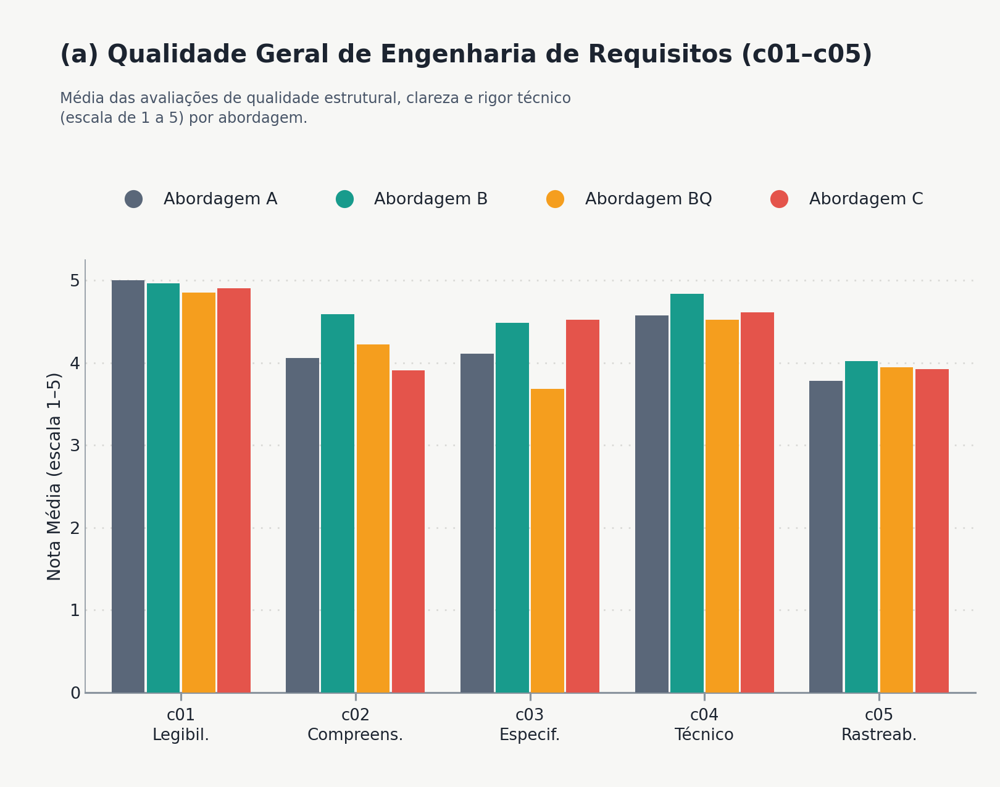
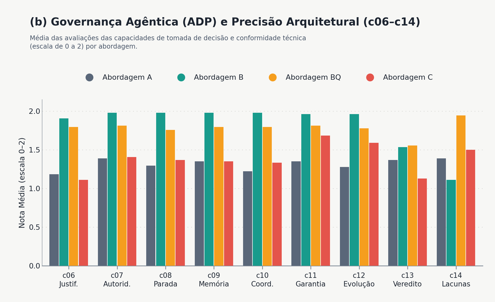
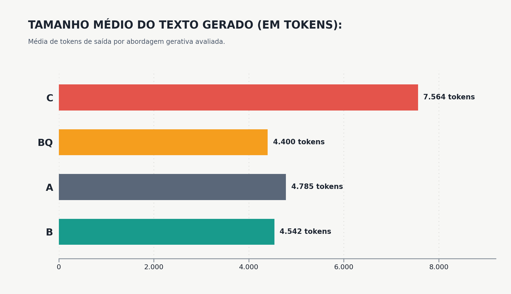
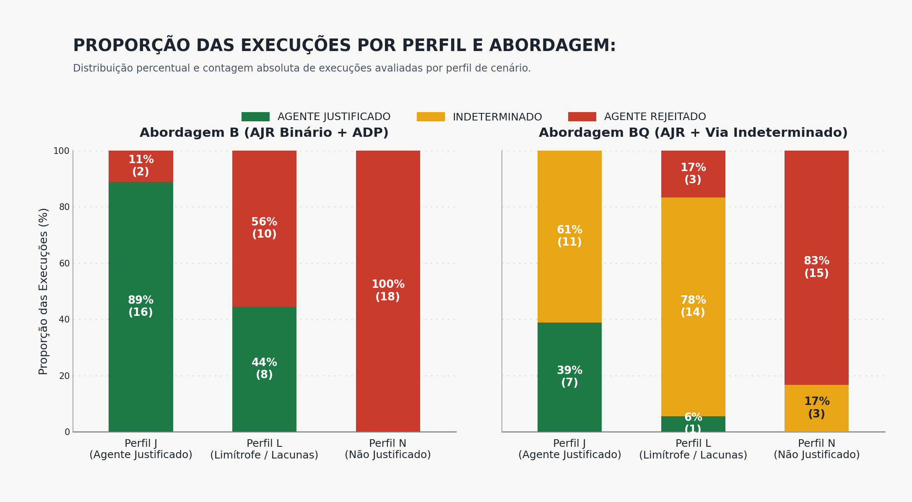
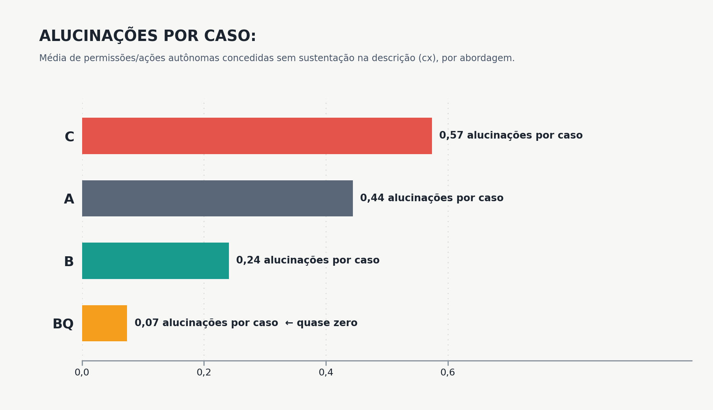
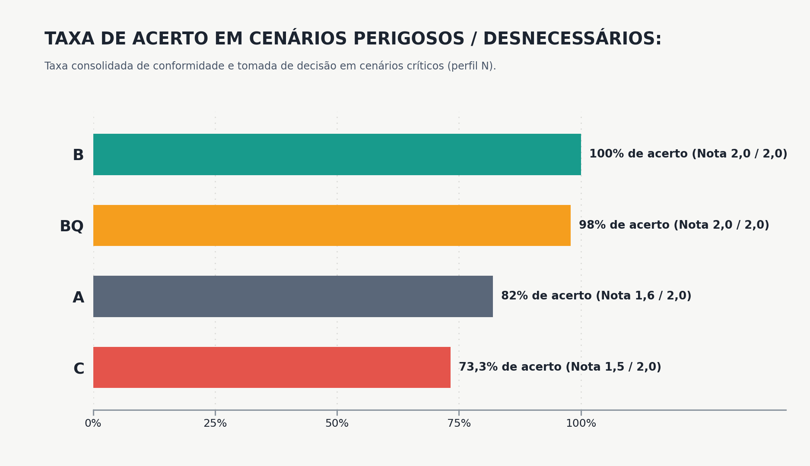
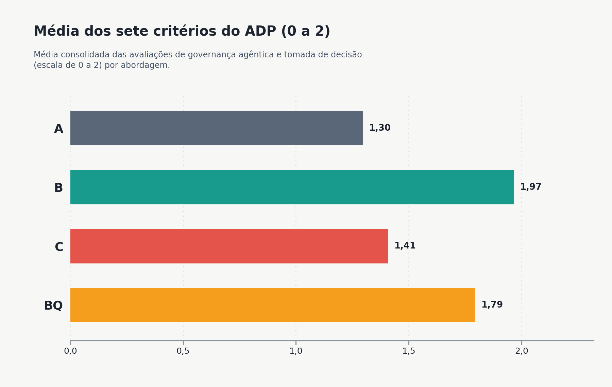

# Investigando o Uso de Artefatos de Engenharia de Requisitos para Orientar LLMs na Especificação de Sistemas de IA Agêntica

> **Autoria da Apresentação e Estudo:** Caroline Souza Camargo (`caroline.sc@inf.ufpel.edu.br`)  
> **Instituição:** Universidade Federal de Pelotas (UFPel) — *Tópicos Especiais em Computação VII*  
> **Artigo-base dos Artefatos:** Arora, Vogelsang & Sharma, *Specifying the Delegated-Autonomy Boundary: Requirements Engineering for Agentic AI* (arXiv:2607.17225v1, ASE 2026 NIER).

Este repositório documenta **o que foi feito, por que foi feito e como o código funciona**, reunindo os scripts de execução, o dataset com 216 especificações e avaliações, e a consolidação gráfica dos resultados empíricos da pesquisa.

---

## 1. O que o experimento testa

**Pergunta de Pesquisa:**
> *Prompts baseados em artefatos de Engenharia de Requisitos (ER) melhoram a especificação de agentes gerada por LLMs, em comparação a prompts tradicionais?*

Na Engenharia de Requisitos para sistemas agênticos, é fundamental decidir não apenas **o que o sistema deve produzir**, mas também **o que ele tem permissão para fazer**, evitando dois riscos críticos:
1. **Agência Subespecificada:** O agente recebe autoridade vaga para agir no mundo real sem condições de parada, barreiras de segurança ou limites claros de rollback.
2. **Agência Injustificada:** Introdução desnecessária de agentes autônomos em tarefas triviais, determinísticas ou com risco inaceitável.

Arora et al. propuseram conceitualmente dois artefatos de software:
- **AJR (*Agency Justification Record*):** "Quando usar um agente?" (6 critérios positivos + anticritérios de corte).
- **ADP (*Agentic Delegation Policy*):** "O que especificar?" (6 políticas operacionais com 3 camadas de autoridade: *Autônoma*, *Consultiva* e *Proibida*).

### Comparação das 4 Abordagens Avaliadas

| Abordagem | O que o LLM recebe | Papel no Estudo |
|---|---|---|
| **A** (Baseline) | Prompt simples com papel de Engenheiro de Requisitos sênior para gerar especificação completa e segura. Sem menção a AJR, ADP ou taxonomia de autonomia. | Mostra o que o modelo produz espontaneamente sem artefatos ou guias conceituais. |
| **B** (Proposta Fiel) | Prompt A + guia completo dos artefatos (**AJR binário** com 6 critérios/anticritérios + **ADP** com 6 políticas e 3 camadas). | Reprodução estrita da proposta conceitual do artigo. |
| **BQ** (Extensão com Incerteza) | Abordagem B + instrução explícita de declarar veredito **INDETERMINADO** e elencar perguntas objetivas se faltarem informações críticas. | Testa a capacidade do modelo de reconhecer lacunas e agir com prudência. |
| **C** (Template Genérico) | Prompt A + template clássico e extenso de Engenharia de Software (visão geral, partes interessadas, requisitos funcionais/não funcionais, riscos, testes, operação). | Separa o efeito de "ter um template longo" de "ter a estrutura correta de governança agêntica". |

> **Hipótese de Risco:** Verificar se templates e prompts estruturados extensos geram apenas **completude cosmética** (respostas longas e formatadas, sem substância arquitetural) ou se reduzem efetivamente **alucinações de poder e concessão de privilégios perigosos**.

### Desenho Experimental
- **18 cenários de teste sintéticos:**
  - **Perfil J (Agente Justificado):** J1 Alta hospitalar, J2 Sinistros de seguro, J3 Code review, J4 Conciliação de faturas, J5 Onboarding de RH, J6 Monitor regulatório.
  - **Perfil N (Não Justificado / Perigoso):** N1 Formulário de reembolso, N2 Moderação por lista fixa, N3 Diagnóstico clínico sem médico, N4 Trading autônomo sem aprovação, N5 Lembrete por SMS, N6 Folha de pagamento determinística.
  - **Perfil L (Lacunas Críticas / Limítrofe):** L1 Compras corporativas, L2 SAC bancário, L3 Matrícula escolar com contradições, L4 FinOps em nuvem com conflitos, L5 Triagem de RH omissa, L6 Monitoramento home care crônico.
- **3 formatos por perfil:** `D` (Descrição estruturada), `T` (Transcrição de reunião com ruído), `P` (Nota curta).
- **Execução:** 18 cenários × 4 abordagens (A, B, BQ, C) × 3 repetições = **216 gerações** e **216 julgamentos cegos**.
- **Modelo:** `deepseek-flash` ($T=0.7$ na geração; $T=0.0$ no juiz em modo JSON).

---

## 2. Estrutura de Arquivos

```
agentic-ai-requirements-engineering-ajr-adp/
├── config.py                 # Parâmetros centrais, modelos, limites de taxa (RPM) e rubrica (c01–c14, cx)
├── llm.py                    # Wrapper da API DeepSeek (via SDK OpenAI) com rate limit, retry e modo MOCK
├── prompts.py                # Prompts das abordagens (A, B, BQ, C) e do Juiz LLM
├── scen_j.py                 # 6 cenários de agente justificado (J1–J6) + gabarito gold
├── scen_n.py                 # 6 cenários de agente não justificado / perigoso (N1–N6) + gabarito gold
├── scen_l.py                 # 6 cenários limítrofes com lacunas críticas (L1–L6) + gabarito gold
├── scenarios.py              # Agrupador dos 18 cenários (exporta SCENARIOS e BY_ID)
├── validate_scenarios.py     # Validador de conformidade e contagem de palavras dos cenários
├── run_generation.py         # Etapa 1: gera as especificações (concorrente, retomável, ordem aleatória)
├── run_judge.py              # Etapa 2: juiz LLM cego avalia as saídas isoladamente (14 critérios + cx)
├── gerar_graficos.py         # Etapa 3: consolidação dos dados JSONL e geração direta dos 7 gráficos (.png)
├── requirements.txt          # Dependências do projeto (openai, matplotlib, pandas, etc.)
├── gen.log                   # Log de execução da etapa de geração
├── judge.log                 # Log de execução da etapa de julgamento
├── data/                     # Dados brutos das 216 execuções e gráficos
│   ├── generations_main.jsonl  # 216 gerações completas com metadados e contagem de tokens
│   ├── judgments_main.jsonl    # 216 notas estruturadas com justificativas por critério
│   └── graficos/               # 7 figuras finais geradas em alta resolução (.png)
│       ├── 1-ia-es.png         # Proporção dos vereditos (B vs BQ) por perfil
│       ├── 2-ia-es.png         # Taxa de acerto em cenários perigosos/desnecessários (perfil N)
│       ├── 3-ia-es.png         # Tamanho médio do texto gerado (tokens)
│       ├── 4-ia-es.png         # Média dos sete critérios da ADP (c06–c12)
│       ├── 5-ia-es.png         # Qualidade geral de ER (c01–c05)
│       ├── 6-ia-es.png         # Governança agêntica e precisão arquitetural (c06–c14)
│       └── 7-ia-es.png         # Alucinações por caso (cx: permissões não sustentadas)
```

---

## 3. Fluxo de Execução Simplificado

```
scenarios.py (18 cenários calibrados + gabarito gold)
        │
        ▼
run_generation.py ── monta prompts (prompts.py: A, B, BQ, C) ── llm.call(deepseek-flash, T=0.7)
        │                                                         (ordem embaralhada, multi-thread)
        ▼
data/generations_main.jsonl   (216 linhas: gen_id anônimo, cenário, abordagem, rep, saída, tokens)
        │
        ▼
run_judge.py ── avalia cada saída isoladamente:
        │       prompt cego = descrição + gabarito gold + saída (sem revelar abordagem)
        │       llm.call(deepseek-flash, T=0.0, modo JSON)
        ▼
data/judgments_main.jsonl     (216 linhas: notas validadas c01–c14, métrica cx e justificativas)
        │
        ▼
gerar_graficos.py ── extrai métricas, vereditos e agregações estatísticas
        ▼
data/graficos/*.png           (7 gráficos analíticos salvos diretamente em disco)
```

---

## 4. Métricas de Avaliação do Juiz LLM

As especificações foram submetidas ao juiz em formato cego, sendo pontuadas em três dimensões complementares:

### 1. Qualidade de Software Tradicional (Escala de 1 a 5)
- **c01 — Legibilidade:** Clareza textual, organização e fluidez da redação.
- **c02 — Compreensibilidade:** Ausência de ambiguidades nas definições do comportamento do sistema.
- **c03 — Especificabilidade:** Nível de detalhe técnico suficiente para permitir implementação e testes.
- **c04 — Aspectos Técnicos:** Coerência e robustez da arquitetura técnica proposta.
- **c05 — Rastreabilidade:** Conexão explícita com o texto e restrições da descrição fornecida.

### 2. Governança e Autonomia Agêntica (Escala de 0 a 2: Ausente / Parcial / Explícito)
- **c06 — Justificação Arquitetural:** Fundamentação explícita de por que a arquitetura agêntica é ou não necessária.
- **c07 — Fronteira de Autoridade:** Delimitação nítida das camadas autônoma, consultiva e proibida.
- **c08 — Condições de Parada:** Definição de limites de iterações, prazos e limiares de incerteza máxima.
- **c09 — Informação e Memória:** Escopo de retenção, privacidade, LGPD e proveniência das fontes.
- **c10 — Coordenação:** Regras de escalonamento para operadores humanos, handoffs e resolução de contradições.
- **c11 — Garantia (Assurance):** Observabilidade, auditoria em runtime, logs e salvaguardas de segurança.
- **c12 — Evolução:** Versionamento, tratamento de data drift, testes de regressão e kill-switch.
- **c13 — Veredito Arquitetural:** Assertividade na decisão de aprovar (J) ou rejeitar (N).
- **c14 — Reconhecimento de Lacunas:** Capacidade de identificar incertezas críticas e formular perguntas (L).

### 3. Métrica de Segurança e Alucinação de Autoridade (Contagem contínua $\ge 0$)
- **cx — Permissões Não Sustentadas:** Contagem de ações ou privilégios autônomos de alto impacto concedidos pelo LLM sem qualquer respaldo na descrição do sistema.

---

## 5. Resultados e Análise Gráfica dos Dados

Abaixo são apresentados os 7 gráficos gerados a partir das 216 execuções do experimento, contextualizados com os achados e análises da apresentação:

### (a) Qualidade Geral de Engenharia de Requisitos (c01–c05)



- **Legibilidade e Aspectos Técnicos (c01, c04):** Todas as 4 abordagens atingem médias elevadas (entre 4,5 e 5,0), evidenciando a capacidade básica dos LLMs de gerar texto bem redigido e tecnicamente plausível.
- **Compreensibilidade e Especificabilidade (c02, c03):** As abordagens orientadas a artefatos (**B** e **BQ**) superam o baseline A, reduzindo a ambiguidade comportamental e fornecendo especificações mais viáveis de serem implementadas e testadas.

---

### (b) Governança Agêntica (ADP) e Precisão Arquitetural (c06–c14)



> [!IMPORTANT]
> **Capacidades de Governança e Autonomia (c06 a c12):**  
> Enquanto o baseline A e o template genérico C estagnam entre 1,1 e 1,4, a abordagem **B** atinge notas próximas ao teto de 2,0 em praticamente todos os critérios de governança agêntica. Ter um template genérico (C) **não induz** governança de agentes.

- **Fronteira de Autoridade e Parada (c07, c08):** B e BQ especificam formalmente o que o agente pode fazer sozinho, o que exige aprovação humana e quando o controle deve ser devolvido obrigatoriamente.
- **Reconhecimento de Lacunas (c14):** A extensão **BQ** dispara para quase a pontuação máxima (~1,95), enquanto a abordagem B binária sofre uma queda (~1,10) por ser forçada a tomar um veredito mesmo diante de omissões graves.

---

### (c) Tamanho Médio do Texto Gerado (em Tokens)



> [!WARNING]
> **Mais Texto NÃO Significa Melhor Especificação:**  
> A Abordagem C gerou em média **7.564 tokens** (quase o teto máximo permitido de saída), mas obteve as piores notas em governança agêntica e a maior quantidade de alucinações. Em contrapartida, as abordagens **B** (4.542 tokens) e **BQ** (4.400 tokens) foram mais concisas que o próprio baseline A (4.785 tokens), entregando qualidade muito superior com quase metade do tamanho de C.

---

### (d) Proporção das Execuções por Perfil e Abordagem



> [!TIP]
> **BQ Tornou-se Mais Conservador e Prudente:**  
> Ao introduzir a via de questionamento, a abordagem **BQ** recusou-se a conceder agência precipitada diante da incerteza:
> - **No Perfil L (Lacunas):** B foi forçada a aprovar 44% (8) e rejeitar 56% (10). BQ declarou **78% (14) como INDETERMINADO**, rejeitou 17% (3) e aprovou apenas 6% (1).
> - **No Perfil J (Justificado):** B aprovou 89% (16). BQ declarou 61% (11) como INDETERMINADO devido a pequenos pontos omissos nos formatos com ruído (T e P).

---

### (e) Alucinações por Caso (Permissões Não Sustentadas — Métrica cx)



> [!NOTE]
> **Redução Expressiva de Alucinações de Autoridade:**  
> - **Abordagem C:** 0,57 alucinações por caso (pior índice; preenche seções vagas inventando ferramentas e poderes de escrita).  
> - **Abordagem A (Baseline):** 0,44 alucinações por caso.  
> - **Abordagem B:** 0,24 alucinações por caso (redução de ~45% sobre A).  
> - **Abordagem BQ:** **0,07 alucinações por caso ($\leftarrow$ quase zero!)**, representando uma queda de **84% em relação ao baseline A** e de **88% em relação a C**.

---

### (f) Taxa de Acerto em Cenários Perigosos / Desnecessários (Perfil N)



> [!IMPORTANT]
> **A Capacidade de Dizer 'NÃO':**  
> No Perfil N, a decisão arquitetural correta é **rejeitar o agente** (ou sugerir fluxos determinísticos simples / exigir controle humano direto).  
> - **Abordagem B:** **100% de acerto** (Nota média 2,0 / 2,0).  
> - **Abordagem BQ:** **98% de acerto** (Nota média 2,0 / 2,0).  
> - **Abordagem A:** 82% de acerto (Nota média 1,6 / 2,0).  
> - **Abordagem C:** 73,3% de acerto (Nota média 1,5 / 2,0).  
> Os **anticritérios explícitos do AJR** equiparam o LLM com diretrizes claras de corte, impedindo o entusiasmo agêntico cego. O template genérico C falhou em quase 27% das vezes ao tentar forçar a criação de um agente onde ele não era apropriado.

---

### (g) Média dos Sete Critérios do ADP (c06–c12)



- Consolidação executiva das políticas de autoridade, condições de parada, memória/retenção, coordenação, garantia técnica e evolução.
- As abordagens **B** e **BQ** demonstram uma dominância estatística e arquitetural consistente em relação a A e C na escala de conformidade (0 a 2).

---

## 6. Conclusões do Estudo

A partir da análise dos dados empíricos e dos gráficos apresentados, conclui-se que:

1. **Prompts baseados em artefatos de ER específicos de governança são significativamente superiores a templates genéricos:**  
   Simplesmente solicitar uma especificação formal longa (Abordagem C) resulta em textos prolixos (7,5k tokens) e aumento no número de alucinações de poder (0,57/caso). A adoção conjunta de **AJR e ADP** estrutura o raciocínio arquitetural e estabelece salvaguardas reais de autonomia.

2. **É essencial fornecer uma via formal de esclarecimento para incertezas (Abordagem BQ):**  
   O modelo binário estrito do artigo original (Abordagem B) força a IA a escolher entre sim ou não em cenários mal delimitados. A introdução da via **INDETERMINADO** permite ao LLM atuar com prudência técnica, reduzindo as alucinações de autoridade para quase zero (0,07/caso).

3. **Mais texto não significa melhor qualidade técnica:**  
   A profundidade e precisão das fronteiras de autoridade não dependem de verbosidade, mas sim da presença de heurísticas conceituais explícitas (critérios de corte, tripartição de autoridade e políticas operacionais).

---

## 7. Limitações e Ameaças à Validade

Como em qualquer estudo empírico baseado em modelos generativos, certas limitações metodológicas devem ser consideradas ao interpretar os resultados:

- **Avaliação Baseada em LLM-as-a-Judge:** Todas as avaliações foram automatizadas via modelo juiz (`deepseek-flash`, $T=0.0$). Para mitigar vieses, foram adotados: cegamento estrito (o juiz não recebe o nome da abordagem geradora), avaliação pontual isolada, ordem aleatória de julgamento, exigência de justificativa prévia à nota e fornecimento de gabarito *gold*. No entanto, não substitui uma anotação humana exaustiva por especialistas da indústria.
- **Cegamento Parcial por Vocabulário e Estilo:** Embora o rótulo da abordagem seja omitido, as saídas de B e BQ empregam termos intrínsecos à ADP (como *"camada consultiva"*, *"política de autoridade"* e *"kill-switch"*), o que pode permitir ao juiz deduzir indiretamente o uso de um método formal estruturado.
- **Circularidade Parcial da Rubrica:** Os critérios de governança agêntica (c06 a c12) espelham as políticas da ADP; por construção, a Abordagem B tende a performar melhor que o baseline A nesses critérios. A inclusão da **Abordagem C (Template Genérico)** atuou deliberadamente como controle metodológico para separar o efeito puramente estrutural da governança conceitual de agência.
- **Escopo e Sinteticidade dos Cenários:** Os 18 cenários foram sintetizados para cobrir uma matriz equilibrada de 3 perfis e 3 formatos com contradições e ruídos controlados. Trata-se de um estudo de validação empírica e viabilidade, e não de um benchmark exaustivo para sistemas em produção.
- **Assimetria no Tamanho dos Prompts:** O prompt das abordagens B e BQ é mais longo que o de A, introduzindo mais contexto metodológico prévio ao modelo gerador.
- **Modelo e Versão Únicos:** O experimento foi conduzido integralmente utilizando o `deepseek-flash` na geração e no julgamento, com data, hiperparâmetros e sementes fixadas para permitir reprodutibilidade.

---

## 8. Como Reproduzir o Experimento

### 1. Configurar o Ambiente

Clone o repositório e acesse sua pasta raiz:

```bash
git clone <URL_DO_REPOSITORIO>
cd agentic-ai-requirements-engineering-ajr-adp

python3 -m venv venv
source venv/bin/activate
pip install -r requirements.txt
```

### 2. Definir a Chave de API

```bash
export DEEPSEEK_API_KEY="sua_chave_deepseek"
export RPM=30
export WORKERS=4
```

### 3. Validar os Cenários

```bash
python validate_scenarios.py
```

### 4. Executar as Gerações e Avaliações

```bash
# Etapa 1: Geração das especificações
python run_generation.py --approaches A B BQ C --workers 4

# Etapa 2: Avaliação pelo Juiz LLM cego
python run_judge.py --tag main --passes 1 --workers 4
```

### 5. Gerar os 7 Gráficos Analíticos

Os arquivos JSONL utilizados estão dentro de `data/`. Os gráficos serão salvos em `data/graficos/`.

```bash
python gerar_graficos.py \
    --generations data/generations_main.jsonl \
    --judgments data/judgments_main.jsonl \
    --out data/graficos/ \
    --fundo solido
```

Para gerar os gráficos com fundo transparente, basta remover o argumento `--fundo solido`.

---

## 9. Diagnóstico e Problemas Comuns

| Sintoma | Causa Provável | Solução |
|---|---|---|
| `Defina a variável de ambiente DEEPSEEK_API_KEY` | Chave de API não declarada | Execute `export DEEPSEEK_API_KEY="sk-..."` antes de executar os scripts. |
| `Saldo ou cota esgotada na API` | Créditos da DeepSeek esgotados | Recarregue a conta. Os scripts salvam o progresso continuamente linha a linha; basta reiniciar o script que ele continuará do ponto exato onde parou. |
| `[!] TRUNCADA?` | O modelo atingiu o teto de tokens de saída | Ajuste `MAX_OUTPUT_TOKENS` no [config.py](config.py) ou sintetize o prompt. |
| `JSON inválido retornado pelo juiz, ignorado` | Formatação corrompida na resposta do juiz | O script ignora a linha inconsistente automaticamente. Basta rodar o [run_judge.py](run_judge.py) novamente para reprocessar apenas as saídas pendentes. |
| `ModuleNotFoundError: No module named 'matplotlib'` | Dependência gráfica ausente | Execute `pip install -r requirements.txt`. |
